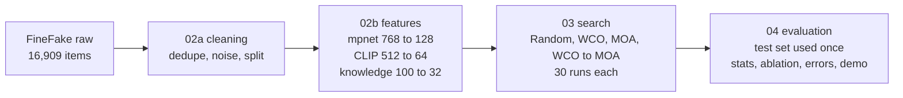
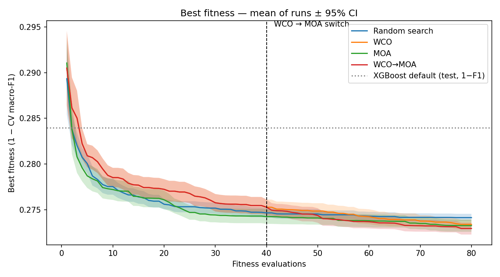
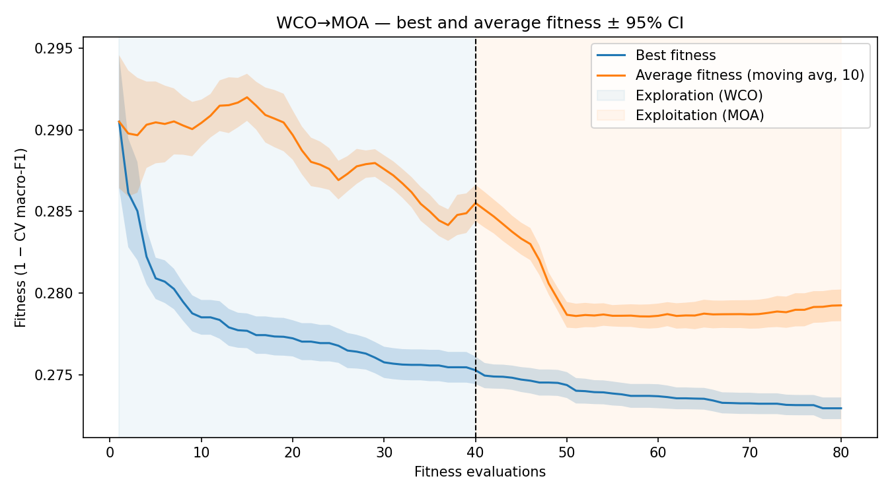

# Multimodal fake news detection with game-based metaheuristics

XGBoost classifiers for fake news detection, with hyperparameters tuned by two game-inspired metaheuristics:
**World Cup Optimization (WCO)** for exploration and the **Morabaraba Optimization Algorithm (MOA)** for exploitation,
combined in a **WCO → MOA hybrid**. Each method is compared with random search over 30 paired runs, with statistical tests.

> **v1.0.** A v2 that fixes the limitations listed below is in progress (see [Roadmap](#roadmap-v2)).

## Two models

| | Model A | Model B |
| --- | --- | --- |
| Data | FineFake | FineFake + FakeNewsNet |
| Inputs | text + image + knowledge | text only |
| Features | 225 | 128 |
| Rows (train / test) | 15,298 (12,238 / 3,060) | 36,516 (29,212 / 7,304) |

## Pipeline



- **Text:** `all-mpnet-base-v2` (frozen), 768 dimensions, PCA to 128.
- **Image:** CLIP `ViT-B/32` (frozen), 512 dimensions, PCA to 64. A missing image gives zeros plus a `has_image` flag.
- **Knowledge:** the FineFake knowledge embedding, 100 dimensions, PCA to 32.
- PCA is fitted on the training rows only.
- **Search space:** 9 XGBoost hyperparameters, encoded in [0, 1]⁹ (learning rate on a log scale).
- **Fitness:** 1 − mean macro-F1 over 3 fixed stratified folds of the training rows.
- **Fair comparison:** every method gets the same evaluation budget (80 for A, 70 for B), and run *r* uses the same seed for every method.

## Results (Model A, test set)

| Model | Macro-F1 | ROC-AUC | Accuracy |
| --- | --- | --- | --- |
| **XGBoost + WCO → MOA** (best CV run) | **0.740** | **0.820** | **0.742** |
| XGBoost default | 0.716 | 0.791 | 0.717 |
| Logistic regression | 0.727 | 0.797 | 0.728 |
| Random forest | 0.722 | 0.797 | 0.726 |
| KNN (k = 15) | 0.673 | 0.755 | 0.674 |

**Search methods, 30 runs each (test macro-F1, mean ± std):**

| Random search | WCO | MOA | WCO → MOA |
| --- | --- | --- | --- |
| 0.7384 ± 0.0034 | 0.7396 ± 0.0032 | 0.7397 ± 0.0040 | 0.7390 ± 0.0030 |

**Feature ablation (same tuned settings):**

| Text only | + image | + knowledge |
| --- | --- | --- |
| 0.714 | 0.734 | 0.740 |

**Main findings:**
- Tuning helps: **+0.024 macro-F1** over default XGBoost (Model A) and +0.028 (Model B).
- Images add the most (+0.020); knowledge adds a little more (+0.006).
- With this budget, the four search methods reach very similar settings. On the test set, Friedman gives p = 0.26 (A) and 0.72 (B), and every Wilcoxon + Holm comparison is non-significant with a negligible Cliff's δ.
- Model B reaches 0.751 macro-F1 overall: 0.756 on FakeNewsNet and 0.698 on FineFake.

| Convergence (Model A) | Hybrid: best and average fitness |
| --- | --- |
|  |  |

## Limitations

- **Small budget:** 80 evaluations for 9 hyperparameters, which may hide differences between the methods.
- **No image ≈ real:** only 115 training rows have no image, and 97 % of them are real, so the model learned that shortcut.
- **Baselines not tuned:** only XGBoost was tuned, so the comparison with the other models is not equal.
- **Ablation reuses settings tuned on all features:** this may overstate the gain from multimodality.
- **Frozen encoders and hand-picked PCA sizes.**
- **MOA mill groups:** the 20 board lines are mapped to hyperparameters by round-robin, which is my interpretation, not the paper's.
- **Platform style:** some source style (for example Reddit) may remain after cleaning.

## Roadmap (v2)

Model A only, with:
- 150 evaluations per run;
- a fitness chosen by experiment (macro-F1, MCC, log-loss);
- a fine-tuned text encoder (out-of-fold) and PCA sizes chosen by cross-validation;
- missing images replaced by the mean training image, with no `has_image` flag;
- stronger removal of subreddit style, with a check of what is left;
- tuned random forest and logistic regression baselines;
- a separate tuned model for each feature set;
- all 6 pairs of methods tested;
- an external test on Fakeddit.

## How to run (Kaggle)

Run the notebooks in order. Attach each notebook's output as an input of the next one (*Add Input*). Use GPU T4 x2 and turn Internet on.

| Model A | Model B |
| --- | --- |
| `01_finefake_exploration` | |
| `02a_finefake_cleaning` | (reuses the 02a output) |
| `02b_features` | `02_joint_text_features` |
| `03_optimization_runs` | `03_joint_runs` |
| `04_evaluation_stats` | `04_joint_evaluation` |

The notebook `03` writes `src/` itself, so it runs standalone on Kaggle. The same code is in `src/` for reading.

## Repository structure

```
notebooks/model_a, notebooks/model_b   the pipeline notebooks
src/                                   fitness.py, metaheuristics/ (common, wco, moa, hybrid)
results/model_a, results/model_b       runs/ (one JSON per run + summary.csv) and eval/ (tables, statistical tests, figures)
figures/                               main figures
report/report.pdf                      the full report (data, method, results, error analysis, limitations)
```

The data (FineFake images, embedding matrices) is not stored here because it is too large. The notebooks download or rebuild it.

## References

- Zhou et al., *FineFake: A Knowledge-Enriched Dataset for Fine-Grained Multi-Domain Fake News Detection*, 2024. [github.com/Accuser907/FineFake](https://github.com/Accuser907/FineFake)
- Shu et al., *FakeNewsNet*. [github.com/KaiDMML/FakeNewsNet](https://github.com/KaiDMML/FakeNewsNet)

## Author

**Sara Nadjet Khiter** · [github.com/29sara29](https://github.com/29sara29)
